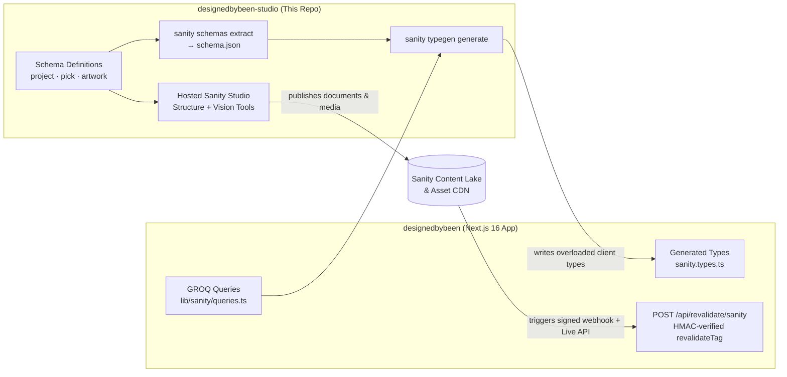

# Designed By Been — Sanity Studio

Headless CMS content studio and schema-driven TypeScript codegen pipeline for the **Designed By Been** portfolio platform (Benji Dunn LLC).

## Overview

This repository defines the content model, editorial workflow, and cross-repository type-generation pipeline powering the [Designed By Been](../designedbybeen) Next.js 16 web application. It provides a hosted, real-time **Sanity Studio v6** environment where non-technical stakeholders (interior designer and architect Brittany Been) manage residential and commercial portfolios, curated product recommendations ("Picks"), and original artwork without requiring developer intervention or code deployments.

## Technology Summary

| Area | Technology | Notes |
| --- | --- | --- |
| CMS Framework | **Sanity Studio v6** (`sanity` ^6.12) | Hosted real-time editorial workspace with auto-updates enabled |
| Language | **TypeScript 5.8** (strict) | Fully typed schema definitions, validation rules, and CLI configuration |
| UI Runtime | **React 19** & **styled-components 6** | Studio desk customization and document preview rendering |
| Query & Debug | **@sanity/vision** | Interactive GROQ query workbench integrated directly into the Studio |
| Code Generation | **Sanity TypeGen** | Extracts `schema.json` and scans frontend GROQ queries to generate end-to-end TypeScript types |
| Code Quality | **ESLint 10** (`@sanity/eslint-config-studio`) & **Prettier 3.5** | Enforces studio schema conventions and formatting |

## Architecture & Cross-Repo TypeGen Pipeline



### Key Engineering Highlights

- **Cross-Repository Type Safety (`npm run typegen`):** Configured via `sanity.cli.ts` to extract the compiled studio schema (`schema.json`), statically analyze GROQ queries across `../designedbybeen/{app,components,lib}/**/*.{ts,tsx}`, and emit `../designedbybeen/sanity.types.ts` with `overloadClientMethods: true`. Any schema change immediately surfaces compile-time TypeScript errors in the Next.js frontend if a query or component falls out of sync.
- **Relational Content Modeling:** The `project` document schema supports relational cross-referencing (`array` of unique `reference` pointers to `pick` documents), enabling reusable product cards that appear both on the global `/picks` masonry board and within project-specific carousels.
- **Media Optimization & Guardrails:** Image fields enable `hotspot: true` for responsive focal-point cropping via the Sanity CDN, paired with structured accessibility (`alt`) and editorial (`caption`, `isCover`) metadata. Video uploads use file-type constraints (`video/*`) tailored for lightweight preview clips.
- **Validation & Editorial UX:** Schema-level validation rules enforce required fields, slug generation from titles, strict category enumerations (`residential` | `commercial`), HTTP/HTTPS URI schemes on external product links, and deduplicated reference arrays. Custom `preview` projections surface thumbnails and subtitles in the Studio desk list.

## Content Model (`schemaTypes/`)

| Document Type | File | Purpose & Key Fields |
| --- | --- | --- |
| `project` | `schemaTypes/project.ts` | Interior design and architecture case studies. Fields: `title`, `slug`, `category` (`residential` / `commercial`), `summary`, `location`, `architect`, `designer`, `coverImage` (with hotspot), `picks` (unique references to `pick`), `gallery` (images with `alt`, `caption`, `isCover`), `videos` (`video/*` files with `caption`), `publishedAt`. |
| `pick` | `schemaTypes/pick.ts` | Curated product recommendations linking to external retailers. Fields: `title` (required), `link` (validated `http`/`https` URL), `image` (required, with hotspot). |
| `artwork` | `schemaTypes/artwork.ts` | Original artwork pieces rendered in the frontend's full-screen interactive carousel and lightbox. Fields: `title`, `image` (with hotspot, `alt`, `caption`), `date`. |

## Project Structure

```text
schemaTypes/
  index.ts          Exports the registered document schema array
  project.ts        Portfolio project document definition & relational references
  pick.ts           Curated product recommendation document definition
  artwork.ts        Original artwork document definition
sanity.config.ts    Studio workspace configuration, plugins (Structure, Vision), and dataset binding
sanity.cli.ts       CLI deployment config and cross-repo TypeGen pipeline settings
schema.json         Extracted serialized schema consumed by Sanity TypeGen
```

## Scripts & Workflows

| Command | Description |
| --- | --- |
| `npm run dev` | Starts the local Sanity Studio development server |
| `npm run typegen` | Extracts `schema.json` and regenerates `../designedbybeen/sanity.types.ts` against frontend GROQ queries |
| `npm run build` | Builds the static Sanity Studio bundle for production |
| `npm run deploy` | Deploys the Studio to Sanity's managed hosting (`autoUpdates: true`) |

